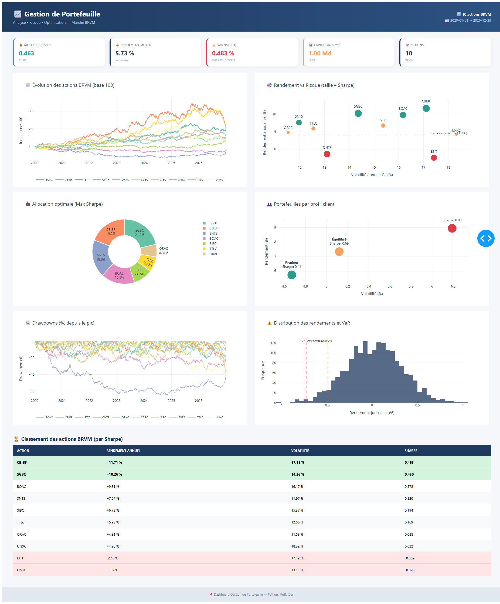
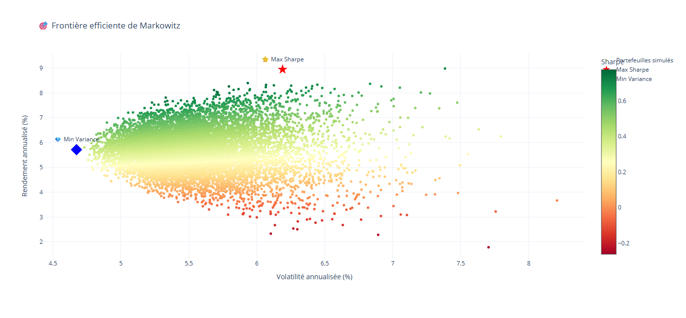
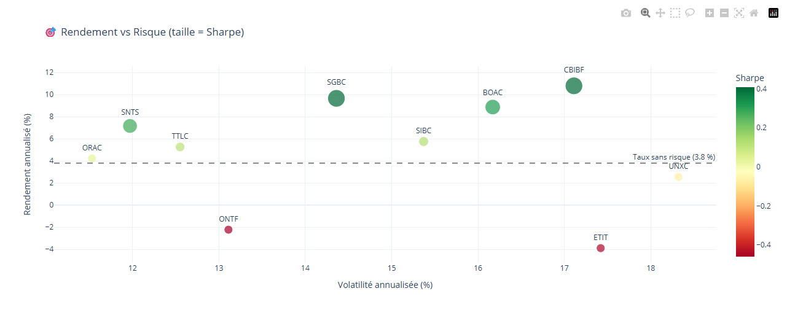
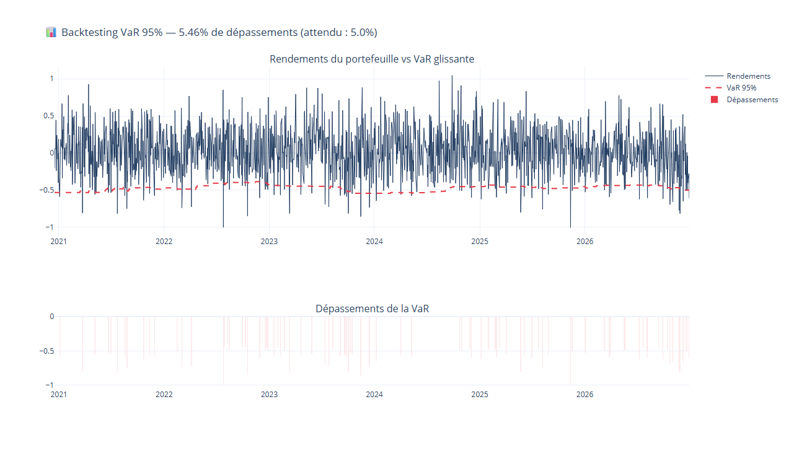
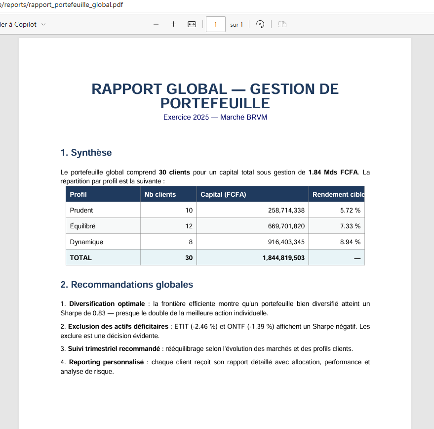

# 📈 Gestion de Portefeuille — Analyse, Risque & Optimisation

[](https://www.python.org/)
[](https://pandas.pydata.org/)
[](https://numpy.org/)
[](https://plotly.com/)
[](https://dash.plotly.com/)
[](https://scipy.org/)
[](LICENSE)

> Application complète de gestion de portefeuille : analyse de performance, calcul de la VaR, optimisation Markowitz et recommandations par profil client — adaptée au marché **BRVM** (actions africaines) et **BEAC** (obligations).

---

## 🎯 Objectif

Construire un **système de gestion d'actifs** pour un service de gestion de patrimoine :

- 📊 **Analyser** la performance de 10 actions BRVM sur 5 ans
- ⚠️ **Mesurer** le risque (VaR, CVaR, drawdowns, stress tests)
- 🎯 **Optimiser** l'allocation via le modèle de Markowitz
- 👥 **Recommander** des portefeuilles adaptés à 3 profils clients
- 📈 **Piloter** via un dashboard interactif
- 📄 **Générer** des rapports PDF personnalisés

---

## 📊 Résultats clés

### 🏆 Performance des 10 actions BRVM (2020-2025)

| Rang | Action | Rendement | Volatilité | **Sharpe** |
|------|--------|-----------|-----------|-----------|
| 🥇 | **CBIBF** (Coris Bank) | +11,71 % | 17,11 % | **0,463** |
| 🥈 | **SGBC** (Soc. Générale CI) | +10,26 % | 14,36 % | **0,450** |
| 🥉 | **BOAC** (Bank of Africa) | +9,81 % | 16,17 % | 0,372 |
| 4 | SNTS (Sonatel) | +7,64 % | 11,97 % | 0,320 |
| 5 | SIBC (SIB CI) | +6,78 % | 15,37 % | 0,194 |
| 6 | TTLC (Total CI) | +5,92 % | 12,55 % | 0,169 |
| 7 | ORAC (Orange CI) | +4,81 % | 11,53 % | 0,088 |
| 8 | UNXC (Uniwax) | +4,20 % | 18,32 % | 0,022 |
| 🔻 | ETIT (Ecobank) | **-2,46 %** | 17,42 % | **-0,359** |
| 🔻 | ONTF (Onatel BF) | **-1,39 %** | 13,11 % | **-0,396** |

### ⭐ Portefeuille MAX SHARPE (Markowitz)

| Métrique | Valeur |
|----------|--------|
| Rendement annualisé | **8,94 %** |
| Volatilité annualisée | **6,19 %** |
| **Ratio de Sharpe** | **0,831** |
| Amélioration vs meilleure action | **+80 %** |

**Allocation optimale** :
- SGBC 21,3 % · CBIBF 19,2 % · SNTS 18,8 % · BOAC 16,9 %
- SIBC 9,6 % · TTLC 7,7 % · ORAC 6,3 %
- **ETIT, ONTF, UNXC exclues** (rendement trop faible)

### 👥 Portefeuilles par profil client

| Profil | Rendement | Volatilité | Sharpe |
|--------|-----------|-----------|--------|
| 🟢 Prudent | 5,72 % | 4,67 % | 0,410 |
| 🟡 Équilibré | 7,33 % | 5,12 % | 0,689 |
| 🔴 Dynamique | 8,94 % | 6,19 % | **0,831** |

### ⚠️ Analyse de risque (capital 1 Md FCFA)

| Indicateur | Valeur | Impact (FCFA) |
|-----------|--------|---------------|
| VaR 95 % (1j) | 0,483 % | **4,83 M** |
| VaR 99 % (1j) | 0,723 % | 7,23 M |
| VaR 99 % (10j) | 2,286 % | **22,86 M** |

**Backtesting VaR** : 5,46 % de dépassements — **conforme** au seuil théorique de 5 % ✅

**Stress tests** :
- Crise 2008 → **-32 %** (-320 M FCFA)
- COVID-19 → -24 % (-240 M FCFA)
- Krach boursier → -20 % (-200 M FCFA)

---

## 🛠️ Architecture du projet

```
gestion-portefeuille/
├── data/
│   ├── raw/
│   │   ├── prix_actions.csv          # 18 250 prix BRVM
│   │   ├── obligations.csv            # 6 obligations BEAC
│   │   ├── clients.csv                # 30 clients
│   │   └── portefeuilles.csv          # 212 lignes d'allocation
│   └── processed/
├── src/
│   ├── data_generator.py              # Étape 1 : Génération
│   ├── analyse_performance.py         # Étape 2 : Performance
│   ├── analyse_risque.py              # Étape 3 : VaR + stress tests
│   ├── optimisation.py                # Étape 4 : Markowitz
│   └── reporting.py                   # Étape 6 : Rapports PDF
├── dashboard/
│   └── app.py                         # Dashboard Dash
├── reports/
│   ├── performance/                   # 5 graphiques HTML
│   ├── risque/                        # 4 graphiques HTML
│   ├── optimisation/                  # 3 graphiques HTML
│   ├── rapports_clients/              # 3 PDF clients
│   ├── rapport_portefeuille_global.pdf
│   └── screenshots/                   # Captures
├── requirements.txt
└── README.md
```

---

## 🚀 Installation & Lancement

### 1. Cloner le projet

```bash
git clone https://github.com/bisneldev/gestion-portefeuille.git
cd gestion-portefeuille
```

### 2. Créer l'environnement virtuel

```bash
python -m venv venv

# Windows
venv\Scripts\activate

# macOS / Linux
source venv/bin/activate
```

### 3. Installer les dépendances

```bash
pip install -r requirements.txt
```

### 4. Exécuter le pipeline complet

```bash
# Étape 1 : Génération des données
python src/data_generator.py

# Étape 2 : Analyse de performance
python src/analyse_performance.py

# Étape 3 : Analyse de risque (VaR)
python src/analyse_risque.py

# Étape 4 : Optimisation Markowitz
python src/optimisation.py

# Étape 6 : Génération des rapports PDF
python src/reporting.py
```

### 5. Lancer le dashboard interactif

```bash
python dashboard/app.py
```
→ Dashboard : **http://127.0.0.1:8053**

---

## 📸 Aperçus

### Dashboard interactif


### Frontière efficiente de Markowitz


### Rendement vs Risque


### Backtesting VaR


### Rapport PDF global


---

## 🔬 Stack technique

| Domaine | Outils |
|---------|--------|
| **Langage** | Python 3.10+ |
| **Data** | Pandas, NumPy |
| **Calcul scientifique** | SciPy (optimisation) |
| **Visualisation** | Plotly Express, Plotly Graph Objects |
| **Dashboard** | Dash |
| **Reporting** | ReportLab (PDF) |

---

## 💼 Cas d'usage bancaire

| Service | Utilisation |
|---------|-------------|
| **Gestion de patrimoine** | Recommandations clients |
| **Salle des marchés** | Analyse portefeuille |
| **Risk Management** | VaR, stress tests |
| **Conseil en investissement** | Optimisation Markowitz |
| **Private Banking** | Rapports clients personnalisés |

---

## 🗺️ Roadmap

- [x] Étape 1 — Génération de données BRVM/BEAC
- [x] Étape 2 — Analyse de performance (Sharpe, drawdowns)
- [x] Étape 3 — Analyse de risque (VaR, CVaR, stress tests)
- [x] Étape 4 — Optimisation Markowitz
- [x] Étape 5 — Dashboard interactif
- [x] Étape 6 — Rapports PDF clients
- [ ] Étape 7 — Intégration données temps réel (API BRVM)
- [ ] Étape 8 — Backtesting de stratégies

---

## 📊 Portfolio Risk Management & Finance

Ce projet complète mon portfolio orienté **Finance + Data** :

| Projet | Domaine |
|--------|---------|
| 🏦 [credit-risk-gabon](https://github.com/bisneldev/credit-risk-gabon) | Risque crédit COBAC |
| 🚨 [fraud-detection-ml](https://github.com/bisneldev/fraud-detection-ml) | Détection fraude ML |
| 📊 [controle-gestion-dashboard](https://github.com/bisneldev/controle-gestion-dashboard) | Contrôle de gestion |
| 📈 **gestion-portefeuille** | Gestion d'actifs |

**Ensemble** = vision 360° des métiers Finance + Data en banque.

---

## 👤 Auteur

**Bisneldev**
- 🎓 Ingénierie Financière — Sciences et Techniques Comptables et Financières
- 💼 Finance, Audit, Contrôle de gestion + Développement d'applications
- 📍 Libreville, Gabon
- 📧 [bisneldev@gmail.com](mailto:bisneldev@gmail.com)
- 💼 [LinkedIn](https://www.linkedin.com/in/bisnel-nzamba)
- 🐙 [GitHub](https://github.com/bisneldev)

---

## 📄 Licence

Ce projet est sous licence MIT — voir le fichier [LICENSE](LICENSE) pour plus de détails.

---

⭐ **Si ce projet vous intéresse, n'hésitez pas à laisser une étoile !**